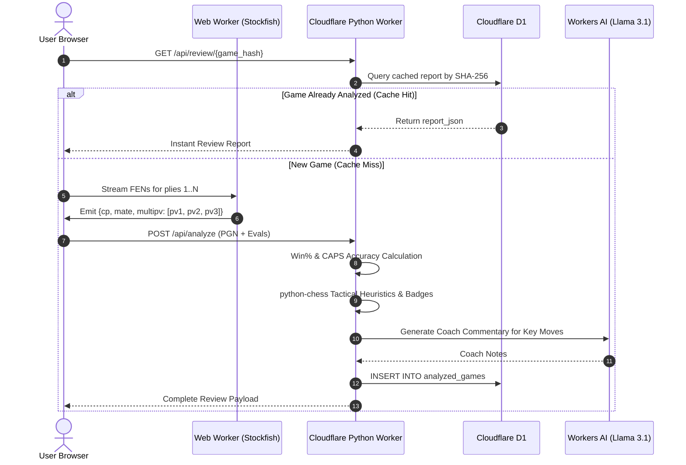

## Building Hindsight: A Free, Edge-Powered Chess Game Review Platform

If you play chess online, you know the feeling. The clock hits zero, your king gets boxed into a corner, or your opponent drops a queen-side rook fork out of nowhere. You stare at the final board state with a single burning question: *Where exactly did this game slip away?*

On Chess.com, the answer is locked behind **Game Review**—that clean, dopamine-heavy breakdown with accuracy percentages, move badges (`Brilliant !!`, `Great !`, `Blunder ??`), and coach commentary. But if you're on a free tier, you get exactly one review per day. After that, you are left staring at raw centipawn numbers (`+2.4`, `-3.8`) or digging through cumbersome engine lines.

I wanted something better for myself and the chess community: an open, completely free, account-free review tool that works seamlessly for both Chess.com and Lichess games. 

The result is **[Hindsight](https://hindsight.almadih.dev/)**.

Here is the story of how it came to life, the multiple failed prototypes that preceded it, the hybrid edge architecture that powers it, and how all the pieces click together without racking up a server bill.

---

## 1. The Post-Game Itch & The Passion for Chess

I’ve been hooked on chess for a year and so now. Whether playing 3-minute blitz during coffee breaks or grinding 10-minute rapid games in the evening, the post-game ritual is always the same:

1. Did I actually play a brilliant move, or was my opponent just oblivious?
2. When did my winning advantage evaporate?
3. What was the tactical refutation I missed?

Raw Stockfish evaluations are great for Grandmasters, but they are terrible communicators for the rest of us. Seeing an eval shift from `+3.1` to `-0.4` tells you *that* you blundered, but it doesn’t tell you *why*. Did you leave a piece undefended? Did you walk into a pin? Did you miss an intermezzo check?

Chess.com solved this user experience masterfully. They translated cold, binary minimax numbers into emotional, narrative verdicts: *Book, Brilliant, Great, Best, Excellent, Good, Inaccuracy, Mistake, Miss, and Blunder*. 

For years, I had an itch: could I reverse-engineer and rebuild this entire game review experience as a high-performance web app?

---

## 2. The Early Prototypes (And Where They Failed)

Building Hindsight was not a weekend sprint. It took several iterations, starting from a recap tool and evolving through two flawed prototypes before finding the right architecture.

### Prototype 0: Chess.com Wrapped (`chess.com`)
My first exploration into the chess ecosystem wasn't a game reviewer at all—it was a **Spotify Wrapped for Chess.com**. 

I dove into Chess.com's public `pub/player/{username}/games/archives` API, wrote PGN parsers, extracted opening repertoires, calculated win/loss streaks across Blitz/Rapid/Bullet, and presented everything in a sleek, glassmorphic interactive story mode. 

```
[Chess.com API] -> [PGN Parser] -> [Win/Loss Stats & Openings] -> [Wrapped Story Slides]
```

This prototype taught me how Chess.com formats PGNs, how rate limits behave, and how much players love seeing their chess stats visualized. But it didn't solve the core problem: move-by-move tactical understanding.

### Prototype 1: The Vite Engine Spike (`chess.com-game-review`)
Next, I created a quick Vite + React spike to test the waters of running Stockfish directly in the browser via WebAssembly (`stockfish.wasm`). It proved that a browser could spin up an engine worker, feed it FEN strings over UCI commands (`position fen ...`, `go depth 16`), and parse evaluation lines asynchronously.

### Prototype 2: The Pure Client-Side Reviewer (`chess.com-game-review-v2`)
Encouraged by Prototype 1, I built a full single-page application in Vite and React. The goal was audacious: do **everything** inside the client's browser.
- Run Stockfish 18 WASM in a Web Worker.
- Traverse the move tree using `chess.js`.
- Compute move accuracy and badge classifications using TypeScript heuristics.

**Why Prototype 2 Hit a Hard Wall:**
1. **JavaScript Lacks Native Chess Primitives:** JavaScript chess libraries like `chess.js` are optimized for board representation and legal move generation. They lack native bitboard operations. Detecting tactical concepts like pins (`is_pinned`), piece attacks (`attackers`), skewers, and material sacrifices in pure TypeScript quickly turned into brittle, buggy spaghetti code.
2. **Device Choke:** Evaluating 60 to 80 plies at depth 16 with `MultiPV = 3` (evaluating top 3 candidate moves per position) is CPU-heavy. Adding complex tactical heuristics on the main UI thread caused browser stutter, fan noise, and phone crashes.
3. **Bloated Bundles:** Identifying ECO opening names required bundling massive opening book dictionaries into the client bundle.
4. **Zero Persistence:** Since there was no backend, every time a user refreshed or shared a link, the browser had to spend 45 seconds recalculating the entire game from scratch.

I realized I needed a **hybrid model**: offload the heavy engine computation to the client so server bills stay at $0, but offload the chess intelligence, database caching, and tactical classification to the edge.

---

## 3. The Tech Stack: The Hybrid Edge Architecture

Version 3—**Hindsight**—was designed from the ground up to solve the constraints of Prototype 2.


### 1. Client-Side Stockfish WASM (`stockfish-19-lite-single.js`)
Stockfish is an absolute CPU monster. If I ran Stockfish on a cloud server for every visitor analyzing 40-move games at depth 16, server hosting costs would be astronomical. 

Instead, Hindsight compiles Stockfish into a lightweight WebAssembly binary run inside client Web Workers. The user's device donates the compute for their own game.

### 2. Cloudflare Python Workers (FastAPI + `python-chess`)
This was the technical linchpin. Cloudflare recently added support for running Python workers powered by Pyodide at the edge. 

Why does this matter? Because **`python-chess`** is the gold standard of chess libraries. It provides battle-tested bitboard logic for queries like:
- `board.is_pinned(color, square)`
- `board.attackers(color, square)`
- Fast FEN fen-stripping and SAN manipulation.

Instead of reinventing bitboards in TypeScript, a sleek FastAPI edge worker handles all classification, tactical evaluation, and game aggregation in milliseconds.

### 3. Cloudflare D1 & KV
- **Cloudflare D1 (Serverless SQLite):** Every analyzed game is hashed using SHA-256 over its normalized move sequence. Once an analysis completes, the full JSON report is stored in D1. If you share your review link with a friend, or reopen a previously reviewed game, it loads **instantly** without running Stockfish again.
- **Cloudflare KV:** Acts as a high-speed proxy and cache for Chess.com/Lichess monthly game archives, and stores the ECO Opening Book lookup table.

### 4. Cloudflare Workers AI (`@cf/meta/llama-3.1-8b-instruct`)
Many AI chess projects fail because they ask LLMs to play or calculate chess moves—something LLMs are notoriously awful at. 

In Hindsight, **the LLM never calculates moves**. Instead:
1. `python-chess` extracts deterministic tactical facts (e.g. `{"type": "pin", "pinned_piece": "knight", "pinner": "bishop", "target": "queen"}`).
2. The edge worker feeds these exact facts to Llama 3.1 via Cloudflare Workers AI (`env.AI.run()`).
3. The LLM acts purely as an expressive translator, turning structured facts into concise, engaging coach notes. If rate limits are exceeded, it cleanly falls back to deterministic rule-based commentary.

---

## 4. How the Pieces Fit Together (The Review Lifecycle)

Here is what happens under the hood when a player requests a review:



### The Early Mate Cutoff Optimization
One of the coolest practical optimizations in our client engine pool (`web/lib/engine/pool.ts`) solved a major latency bug.

When running Stockfish with `MultiPV = 3`, if move 1 has a forced mate-in-1, Stockfish would continue grinding for 25+ seconds trying to find alternative lines for `PV2` and `PV3` to reach depth 16!

We implemented an intelligent early-stopping condition:
```typescript
// Once PV1 is a mate that the search has fully confirmed,
// deeper search only wastes time on secondary lines.
if (!stopped && info.multipv === 1 && info.mate !== undefined && info.depth >= 2 * Math.abs(info.mate)) {
  stopped = true;
  this.worker.postMessage("stop");
}
```
This single tweak dropped analysis time on tactical/checkmate games from over 40 seconds down to under 12 seconds.

---

## 5. The Math Under the Hood

To make the review feel just like the one players know and trust, I calibrated the scoring math against real Chess.com games.

### 1. Centipawns to Win Probability
Raw centipawns are non-linear: an advantage of `+1.0` at move 5 is substantial, but `+10.0` vs `+15.0` makes virtually no difference to the game outcome. We transform centipawns (`cp`) into Win Percentage (`Win%`) using a logistic sigmoid:

```python
def win_pct(cp: float) -> float:
    # Logistic sigmoid mapping centipawns (-1000 to +1000) to 0% - 100%
    return 50 + 50 * (2 / (1 + math.exp(-0.00368208 * cp)) - 1)
```

*(For forced checkmates, scores map to `±(10,000 - 10 × N)` so faster mates score higher).*

### 2. Move Accuracy Formula
From the change in win probability between consecutive moves (`ΔW = max(0, Win_before - Win_after)`), we compute individual move accuracy:

```python
# Fitted against Chess.com's own accuracies on 30 rated games across 5 rating bands
LOSS_SCALE = 2.2

def move_accuracy(win_lost: float) -> float:
    scaled_loss = LOSS_SCALE * max(0.0, win_lost)
    return max(0.0, min(100.0, 103.1668 * math.exp(-0.04354 * scaled_loss) - 3.1669))
```

And for overall game accuracy, we use a weighted blend of arithmetic and harmonic means so a single catastrophic blunder pulls down the final score realistically:

```python
def game_accuracy(accuracies: list[float]) -> float:
    arithmetic = sum(accuracies) / len(accuracies)
    harmonic = len(accuracies) / sum(1 / max(a, 1.0) for a in accuracies)
    return 0.9 * arithmetic + 0.1 * harmonic
```

### 3. The Move Classification Matrix

Using `python-chess` bitboard heuristics paired with the engine's `MultiPV` candidate lines, every move receives one of ten precise verdicts:

- **Book** (`📖`): The board position matches an opening FEN in the Cloudflare KV ECO database.
- **Brilliant** (`!!`): The best engine move (`ΔW < 2%`) involving an intentional piece sacrifice (moving to a square attacked by a lower-value piece or leaving friendly material undefended) in a contested position (`Win% < 85%`).
- **Great** (`!`): The player found the *only* winning or saving move (`PV1`), with a win probability gap of `≥ 20%` over the engine's second-best candidate (`PV2`).
- **Best** (`★`): The top engine recommendation (`PV1`) or any move with negligible win probability loss (`ΔW < 1%`).
- **Excellent** (`👍`): A solid, strong move with minimal equity loss (`1% ≤ ΔW < 3%`).
- **Good** (`✓`): A reasonable move that keeps the game in balance (`3% ≤ ΔW < 5%`).
- **Inaccuracy** (`?!`): A slight positional concession (`5% ≤ ΔW < 10%`).
- **Mistake** (`?`): A noticeable error that gives away substantial equity (`10% ≤ ΔW < 20%`).
- **Blunder** (`??`): A critical error costing `≥ 20%` win probability or walking straight into a forced mate.
- **Miss** (`❌`): The opponent blundered on the preceding ply (`ΔW_opp ≥ 15%`), but the player failed to punish it tactically (`ΔW ≥ 10%`).

---

## 6. What Can Be Done to Improve It

Hindsight is live and working at **[hindsight.almadih.dev](https://hindsight.almadih.dev/)**, but there are several exciting directions for future iteration:

1. **WebGPU & SIMD Acceleration:** Currently, Stockfish runs single-threaded WASM. Compiling with SIMD and exploring WebGPU worker threads could cut analysis time on mobile phones by another 50%.
2. **Personal Opening Leak Detector:** By aggregating analyzed games stored in D1 for a given username, we could automatically flag openings where a player consistently falls below 70% accuracy.
3. **Automated Blunder Puzzles:** Every time you blunder or miss a tactical win in your games, Hindsight could generate a personalized interactive puzzle for you to practice.
4. **Collaborative Review Rooms:** Using Cloudflare Durable Objects or WebSockets to allow a coach and student to step through a shared review in real time.

---

## Conclusion

Building Hindsight taught me that modern web architecture doesn't have to choose between expensive cloud servers and limited client-side code. By pairing **client-side WebAssembly compute** with **Python edge microservices and serverless storage**, you can build applications that feel instant, offer enterprise-grade analysis, and remain completely free to run.

Give your recent games a review at **[hindsight.almadih.dev](https://hindsight.almadih.dev/)**, check out your accuracy, and see what moves you missed!
